# Dashboard Summary: Looker Studio

**Purpose:** give merchandising leaders one view of promotions, margin, customers and data quality across four channels, with every number reconciled to the source data.
**Structure:** 13 pages in five sections. Each page answers one question and states its finding in the title.
**Live report:** [Looker Studio](ADD-PUBLISHED-LINK-HERE) (view only) · [PDF export](docs/AURA_dashboard.pdf)

Figures are from the synthetic dataset, January 2025 to September 2026: 49,875 orders, 7,945 customers, $16.68M net revenue.

| Section | Pages | Question |
| --- | --- | --- |
| A. Where we stand | 1 to 2 | How is the business doing, and when does it peak? |
| B. Do promotions pay? | 3 to 6 | Which promotions create margin, and how certain are we? |
| C. Who responds | 7 to 9 | Who carries revenue, and who comes back? |
| D. Category and inventory | 10 to 12 | Which categories and brands work hardest? |
| E. Can we trust it? | 13 | Do the numbers reconcile? |

---

## A. Where we stand

### Page 1: Executive Scorecard
**Question:** Where does the business stand today?
**Headline:** Net revenue is $16.68M at a 45.4% gross margin; returns pull it to 38.6%.
**Shows:** five scorecards (net revenue, gross margin %, GMROI, order value, return rate) and revenue with margin % by selling channel.
**Read it for:** AOV is $334.49 and 15.5% of orders are returned. Off-price channels earn about 5.7 points less margin than full-line (41.6% vs 47.3%) on 33% of revenue.

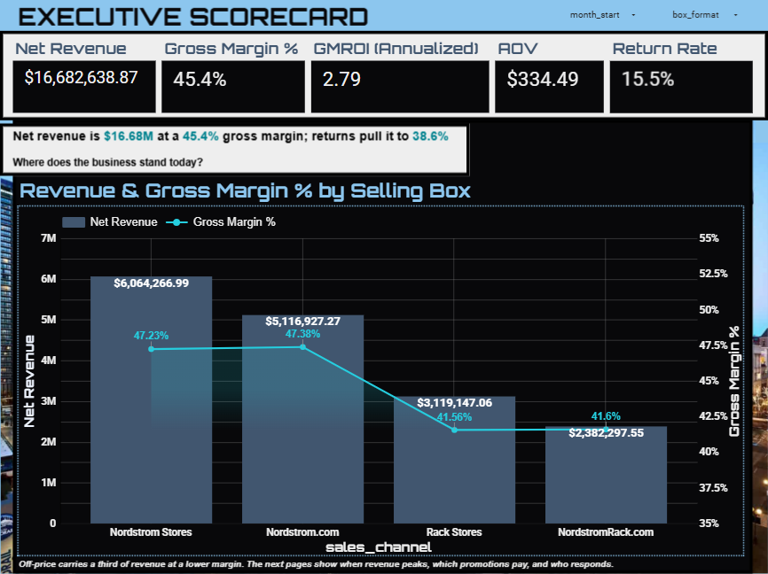

### Page 2: Seasonality and Events
**Question:** When does revenue peak, and what does it cost in margin?
**Headline:** Revenue peaks in November, December and each July, and margin dips in the same sale months.
**Shows:** monthly net revenue and monthly gross margin % by format; a promotion calendar with one row per event.
**Read it for:** Full-line margin drops to 41.6% in July 2026 while revenue peaks. Nine events ran in 21 months; Black Friday ran in all four channels, so it has no control group.

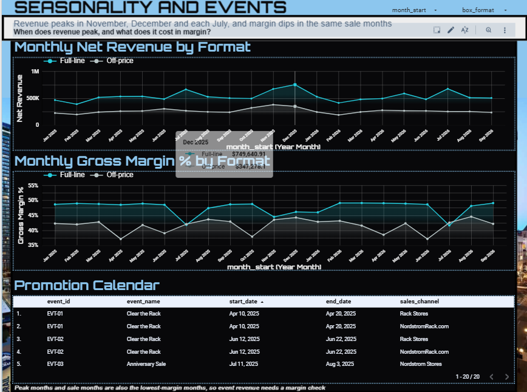

## B. Do promotions pay?

### Page 3: Promotion Verdict
**Question:** Which promotions pay when cannibalization is included?
**Headline:** Clear the Rack events added $17k of revenue but lost $64k of margin once Nordstrom.com cannibalization is counted.
**Shows:** gross margin effect and net revenue effect by event family, against control channels.
**Read it for:** across five events, Rack channels gained $119k of revenue and lost $15.2k of margin; Nordstrom.com lost $102k of revenue and $48.4k of margin. The Anniversary Sale added $22.4k of margin.

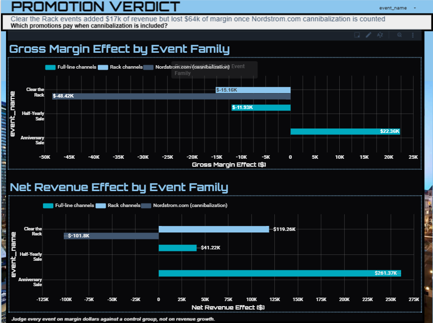

### Page 4: Naive vs Controlled Lift
**Question:** Does controlling for seasonality change the answer?
**Headline:** A simple before-and-after view would have misread two of the five Clear the Rack events.
**Shows:** a table of naive and controlled (difference-in-differences) revenue and margin lift for every event.
**Read it for:** for EVT-04 and EVT-07 the naive view shows margin gains (+17.5% and +8.7%) where the controlled view shows losses (-8.5% and -36.9%).

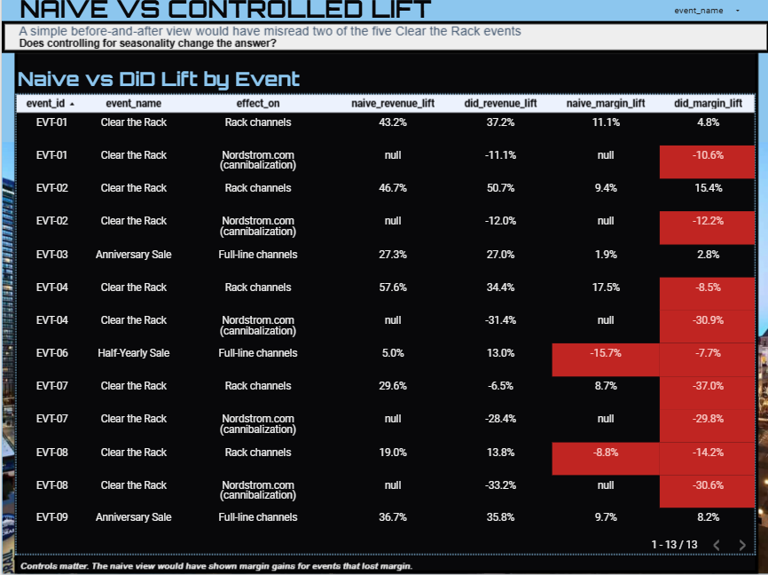

### Page 5: Is the Effect Real?
**Question:** How certain are the estimates?
**Headline:** Only the Nordstrom.com margin loss is statistically clear; Rack-channel and Anniversary margin effects include zero.
**Shows:** pooled effect estimates with 95% confidence intervals and p-values, per channel-day.
**Read it for:** Nordstrom.com loses about 3.8 orders and $882 of margin per day during Rack events. The Rack-channel (-$135) and Anniversary (+$233) margin effects are directional only.

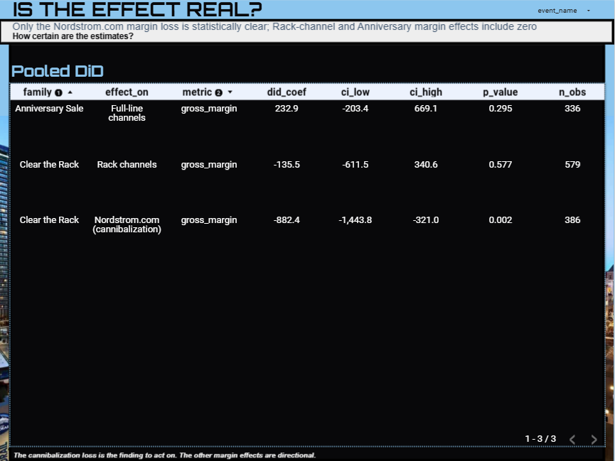

### Page 6: Discount Economics
**Question:** How much extra volume would a discount need?
**Headline:** No discount band earns back its margin through volume alone.
**Shows:** margin per order, observed unit lift and break-even unit lift by discount band, for full-line and Off-price.
**Read it for:** at 41% to 50% off in Rack, a +55% unit lift is observed against +1,176% needed. Bands compare different shoppers, so this page is descriptive; the controlled pages carry the causal evidence.

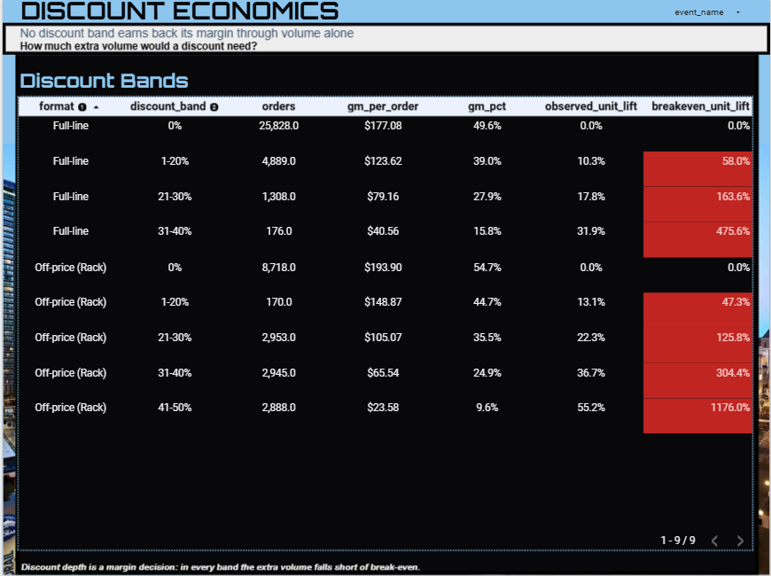

## C. Who responds

### Page 7: Customer Value
**Question:** Who carries revenue, and who responds to promotions?
**Headline:** Core loyalists are 47% of buyers and 81.5% of revenue; deal seekers are 20% of buyers and 6.6%.
**Shows:** revenue share by statistical customer segment and a segment profile (customers, revenue, orders, promo share, recency).
**Read it for:** deal seekers place about 75% of their orders on promotion but generate 6.6% of revenue.

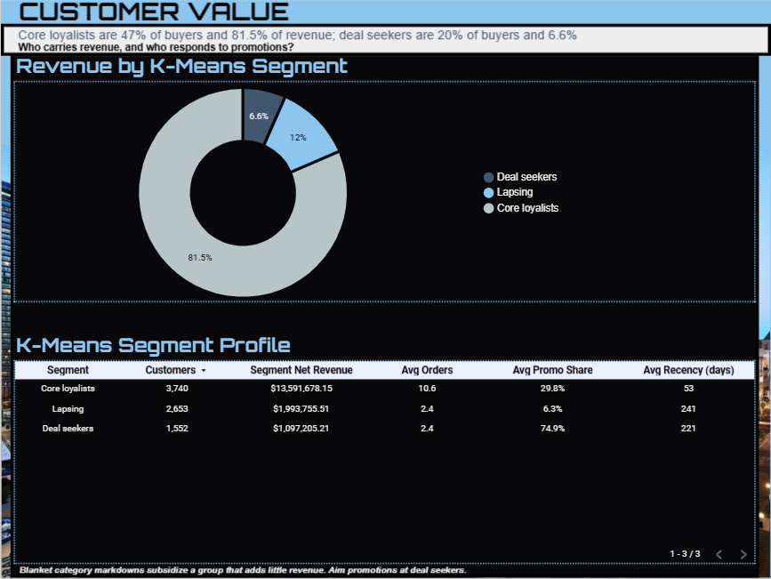

### Page 8: RFM and Loyalty
**Question:** How does value concentrate in rule-based segments and loyalty tiers?
**Headline:** Champions are 27% of buyers and 55.5% of revenue; the 300 Icon members generate 15.6%.
**Shows:** rule-based RFM segments (recency, frequency, spend) and revenue by loyalty tier.
**Read it for:** this page and Page 7 use different segmentations that answer different questions; they are not interchangeable.

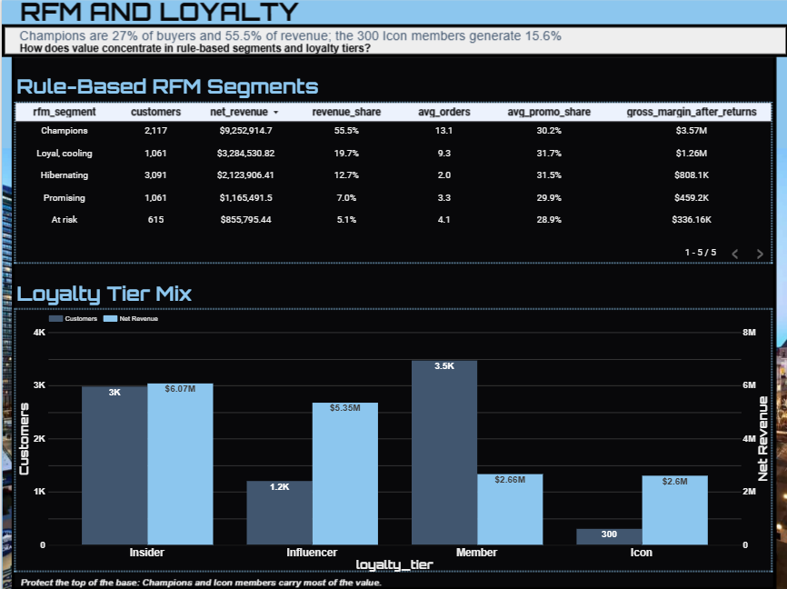

### Page 9: Repeat Purchase
**Question:** Do customers come back, and does format matter?
**Headline:** About 38% of orders are followed by another within 30 days, in both formats.
**Shows:** 30-day repeat rate for Full-line (38.3%) and Off-price (38.1%), and the monthly trend.
**Read it for:** both formats peak in November 2025 (46.6% and 47.1%). Orders in the last 30 days of data are excluded because their window is incomplete.

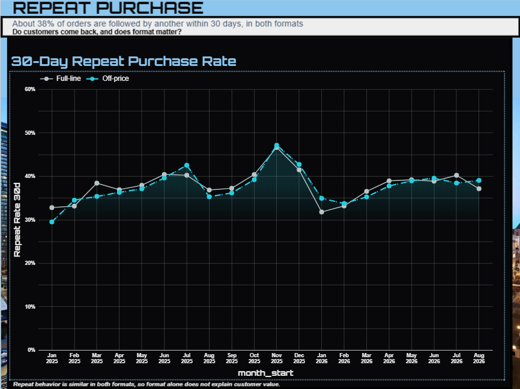

## D. Category and inventory

### Page 10: Category Health
**Question:** Which box-and-category combinations are healthiest?
**Headline:** Full-line Beauty ranks first on category health; Off-price Handbags ranks last.
**Shows:** a Category Health Index across ten format-and-category rows, with GMROI, return-adjusted margin, repeat rate and promotion dependence.
**Read it for:** the index is a percentile rank across those ten rows, so it orders them but is not an absolute score. Four of the five lowest rows are Off-price.

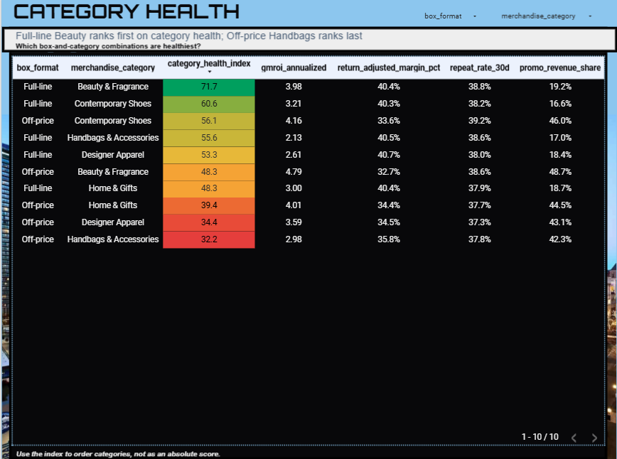

### Page 11: Inventory Productivity
**Question:** Where does inventory work hardest?
**Headline:** Beauty earns the most per inventory dollar (GMROI 4.20); Handbags turn slowest despite the highest margin.
**Shows:** GMROI by category and format, and a category productivity table (revenue, margin %, GMROI, turns, promo share).
**Read it for:** gross margin is similar across categories (44.4% to 45.8%); GMROI differs because inventory turns differ (5.26 in Beauty, 2.76 in Handbags).

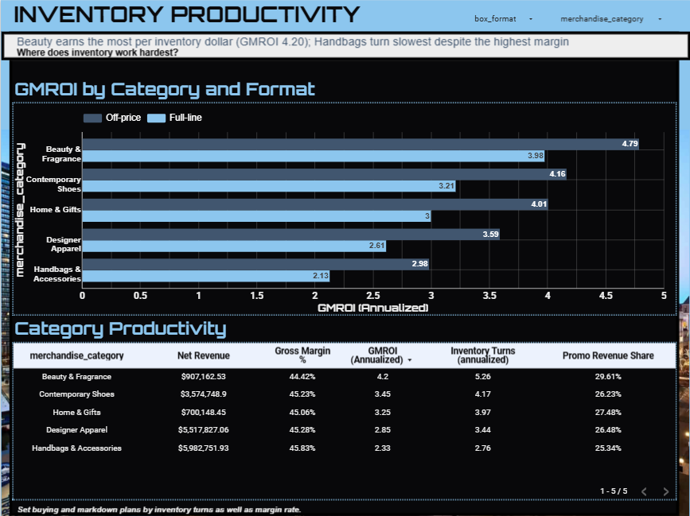

### Page 12: Price Response and Brands
**Question:** Which categories react most to price, and which brand tiers earn the most margin?
**Headline:** Beauty is the most price-responsive category, and Luxury brands earn the lowest margin.
**Shows:** price-response estimates with confidence intervals by category, and gross margin by brand tier and format.
**Read it for:** Luxury earns 42.8% and Contemporary 48.7%; Off-price is lower in every tier. Price-response estimates are attenuated, so read the ranking, not the size.

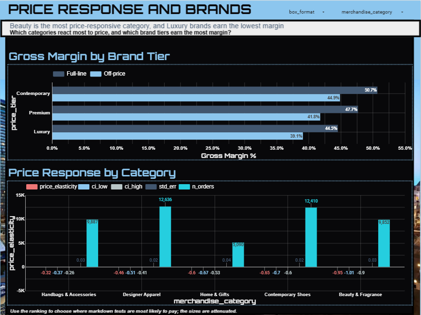

## E. Can we trust it?

### Page 13: Data Trust
**Question:** Can I rely on these numbers?
**Headline:** Every raw row is accounted for: 50,150 = 150 duplicates + 125 rejects + 49,875 staged.
**Shows:** row reconciliation, rejected rows by reason, channel-days with no orders, and revenue anomaly flags.
**Read it for:** two NordstromRack.com days (March 14 and 15, 2026) have no orders and are treated as telemetry gaps. Four of five anomaly flags fall inside promotion windows; April 6, 2025 needs analyst review.

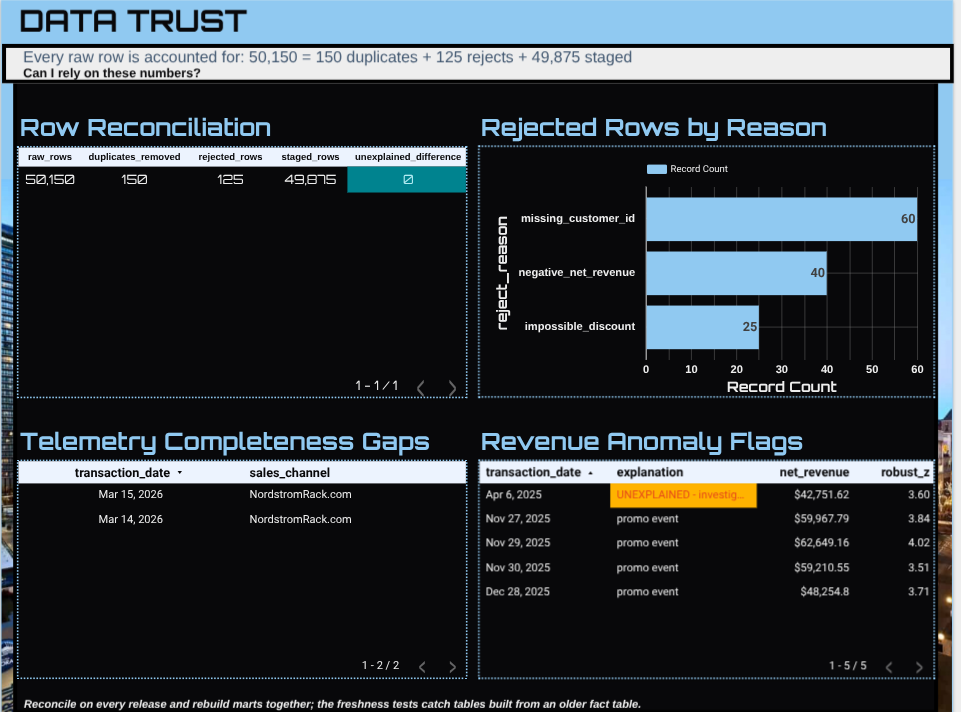

---

## Metric definitions

| Metric | Definition |
| --- | --- |
| Net revenue | Revenue after discounts |
| Gross margin | Net revenue minus cost of goods sold; shown in dollars and as a percent of net revenue |
| Return-adjusted margin | Gross margin after setting margin to zero on returned orders, as a percent of net revenue |
| GMROI (annualized) | Gross margin divided by average inventory at cost, times 12 |
| Inventory turns (annualized) | Cost of goods sold divided by average inventory at cost, times 12 |
| AOV | Net revenue divided by orders |
| Return rate | Returned orders divided by orders |
| Promo revenue share | Net revenue from discounted orders divided by net revenue |
| 30-day repeat rate | Share of orders followed by another order from the same customer within 30 days |
| Category Health Index (0 to 100) | Percentile-rank blend: 35% GMROI, 25% return-adjusted margin, 20% repeat rate, 20% low promo dependence |

All ratios are calculated from summed numerators and denominators, never from averages of stored ratios.

## How to read the dashboard

- The left navigation lists the 13 pages in story order. Each page title states the finding, and each visual has a caption beneath it.
- The date control filters the tiles built on monthly performance data: Page 1, the monthly trends on Page 2, and the GMROI and category productivity tiles on Page 11. All other analysis tiles show the whole period, January 2025 to September 2026.
- Event effects are per channel-day unless a total is stated.

## Data and refresh

- Source: BigQuery dataset `merchandising_insights`; the report reads marts and analysis tables only.
- Refresh: after any rebuild, run `sql/06` and `sql/07`, then refresh the report data.
- Access: view only; viewers need no database permissions.

## Validation

Each tile was checked against values recomputed from the order-level fact table and the analysis tables, with 202 expected values across the 13 pages. See [docs/Methodology_and_Validation.md](docs/Methodology_and_Validation.md).
